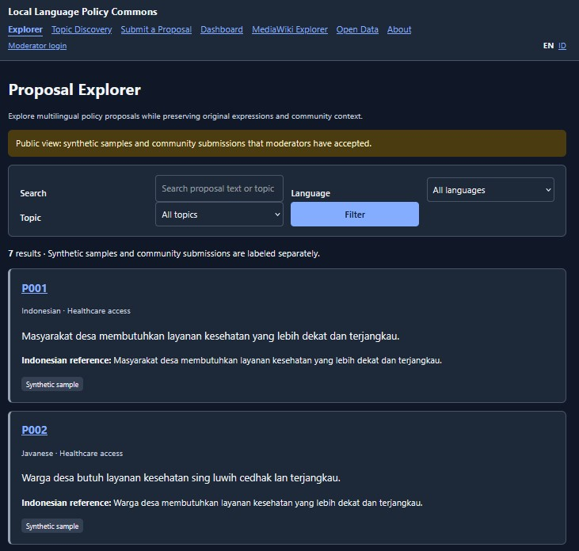
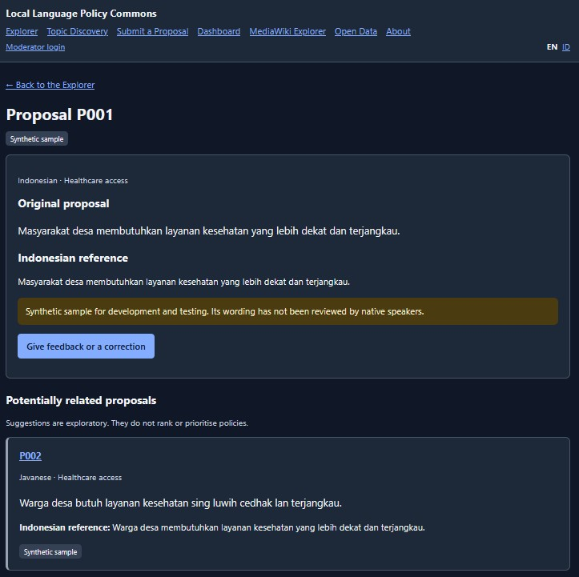
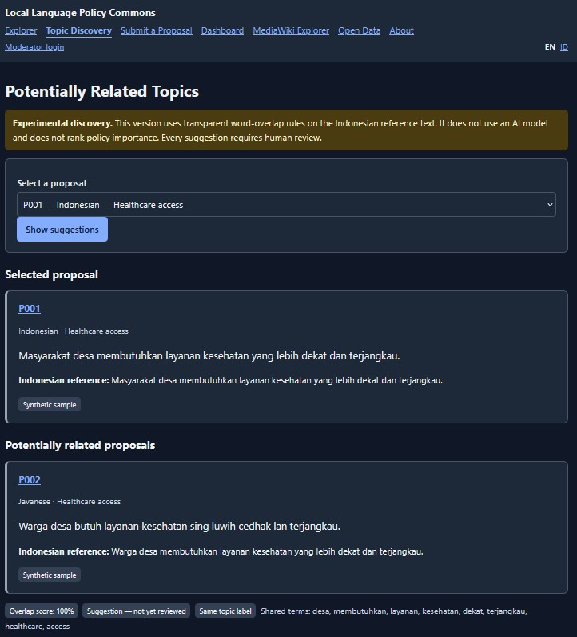
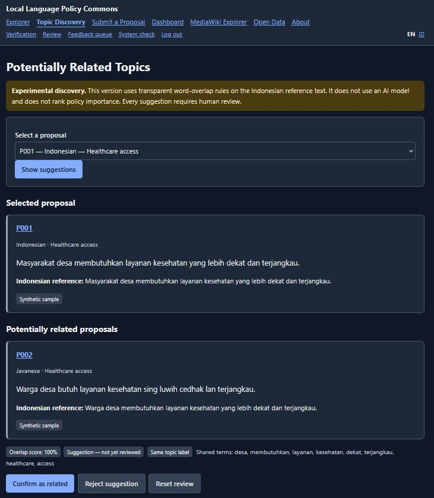
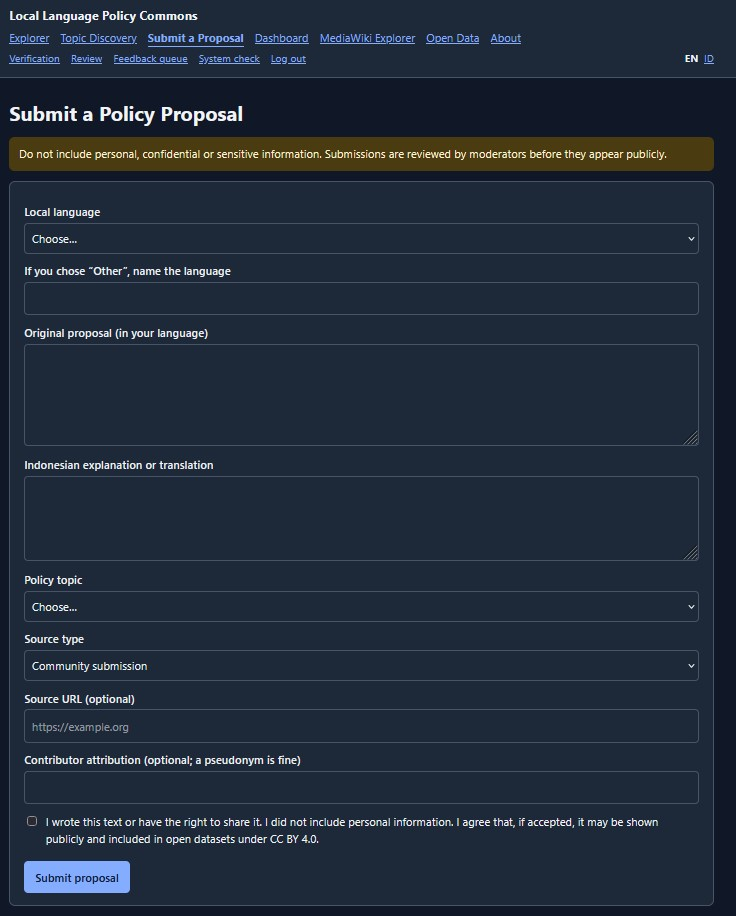
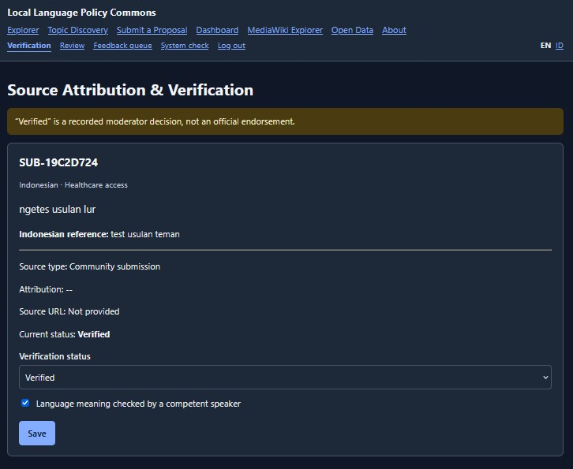
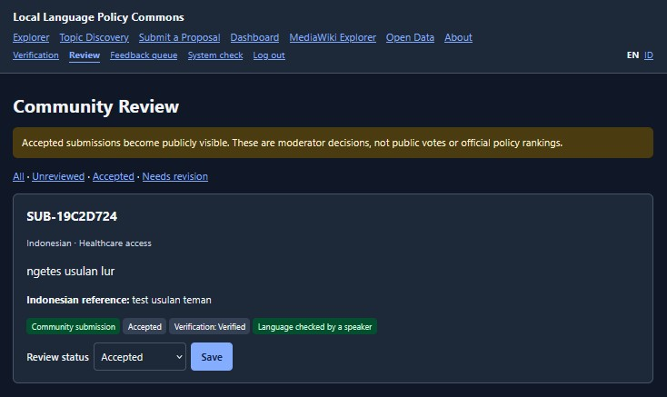
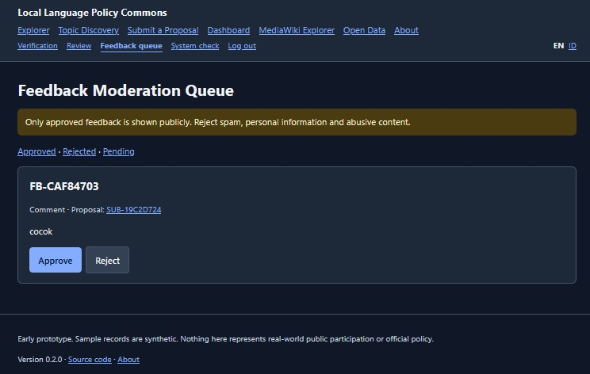
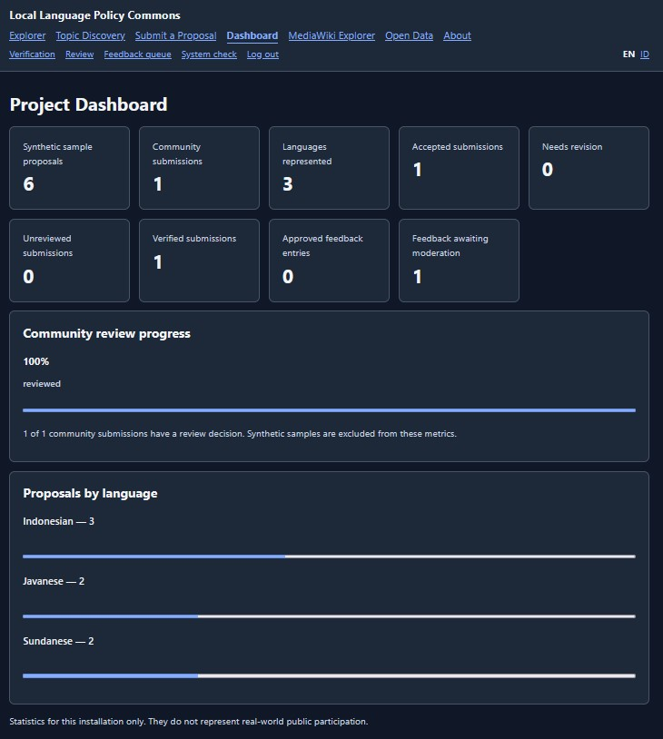

# Local Language Policy Commons

[](https://github.com/ArkFunDev/local-language-policy-commons/actions/workflows/ci.yml)
[](LICENSE)


**Perangkat sumber terbuka dengan peran manusia di dalam prosesnya, untuk menjelajahi usulan kebijakan yang ditulis dalam bahasa-bahasa daerah Indonesia — tanpa meleburkannya ke dalam satu bahasa.**

🇬🇧 [Read in English](README.md)

## Mengapa proyek ini ada

Anak muda di seluruh Indonesia menulis usulan kebijakan dalam bahasa daerah mereka. Banyaknya usulan dan beragamnya bahasa membuat sulit melihat di mana usulan saling beririsan, siapa yang menyuarakan kekhawatiran serupa, dan gagasan mana yang layak dicermati. Kebanyakan alat digital mengandaikan satu bahasa dominan dan meminta komunitas menerjemahkan dirinya sendiri.

Local Language Policy Commons mengambil pendekatan sebaliknya:

- **Redaksi asli adalah sumber kebenaran.** Setiap usulan ditampilkan dalam bahasa aslinya, dengan teks rujukan Bahasa Indonesia di sampingnya, bukan sebagai penggantinya.
- **Perangkat lunak menyarankan, manusia memutuskan.** Saran topik lintas bahasa bersifat eksploratif. Moderator dan penutur mengonfirmasi atau menolak setiap saran, dan antarmuka selalu menunjukkan mana yang otomatis dan mana yang keputusan manusia.
- **Tidak ada peringkat gagasan.** Sistem tidak pernah menilai kepentingan kebijakan atau "popularitas".
- **Transparan secara bawaan.** Setiap saran menampilkan kata-kata persis yang melahirkannya.

Proyek ini adalah upaya independen yang selaras dengan misi [BASAibu](https://basabali.org), platform yang dikelola komunitas untuk partisipasi sipil anak muda dalam bahasa daerah. Proyek ini **bukan** produk resmi BASAibu kecuali dinyatakan lain.

## Status saat ini — prototipe berfungsi (v0.2)

## Tangkapan layar

> Data demo bersifat sintetis. Gambar menunjukkan prototipe v0.2.

### Jelajah dan temukan

| | |
|---|---|
|  |  |
| **Jelajahi** usulan dalam bahasa aslinya | **Detail:** redaksi asli lebih dulu, Bahasa Indonesia sebagai rujukan |
|  |  |
| **Saran yang dapat dijelaskan** menampilkan kata bersama | **Manusia memutuskan:** konfirmasi atau tolak tiap pasangan |

### Berkontribusi dan moderasi

| | |
|---|---|
|  |  |
| **Kirim** dengan persetujuan lisensi yang eksplisit | **Verifikasi** sumber, atribusi, dan makna bahasa |
|  |  |
| **Tinjau:** hanya kiriman yang diterima yang tampil publik | **Masukan dimoderasi** sebelum tampil di publik |

### Ringkasan



**Dasbor** instalasi ini: kemajuan tinjauan dan jumlah menurut bahasa.

Repositori ini berisi prototipe yang berjalan dan bisa dicoba dalam satu menit. Mohon baca ringkasan jujur berikut.

**Yang sudah berfungsi**

| Area | Kemampuan |
|---|---|
| Jelajah | Pencarian, filter bahasa/topik, penjelajah dengan halaman; halaman detail usulan dengan atribut `lang` agar pembaca layar mengucapkan teks dengan benar |
| Kirim | Formulir kiriman publik dengan 22 pilihan bahasa, daftar topik, atribusi sumber, persetujuan lisensi eksplisit, honeypot, dan pembatasan laju |
| Moderasi | Login moderator (dibatasi laju), verifikasi sumber, alur tinjau/terima, antrean moderasi masukan, log audit |
| Temukan | Saran kesamaan kata yang transparan dengan kata bersama ditampilkan; moderator dapat mengonfirmasi atau menolak setiap pasangan |
| Integrasi | Klien API MediaWiki baca-saja (HTTPS, cache, User-Agent deskriptif); moderator dapat mengimpor halaman wiki sebagai kiriman *tertunda* |
| Data terbuka | Ekspor JSON/CSV publik untuk rekaman yang diterima dan disetujui (CSV terlindung dari formula injection) |
| Kualitas | Antarmuka dwibahasa (Inggris / Indonesia), markup aksesibel, mode gelap, tanpa JavaScript, Content-Security-Policy ketat, tes otomatis dan CI |

**Yang *tidak* diklaim**

- Belum ada penerapan produksi dan pengguna nyata. Angka di dasbor hanya menggambarkan instalasi lokal.
- 6 usulan contoh bersifat **sintetis**; redaksi bahasa daerahnya **belum** ditinjau penutur asli.
- Kesamaan saat ini memakai **dasar kesamaan kata yang sederhana dan transparan pada teks rujukan Bahasa Indonesia**. Ini *bukan* model pembelajaran mesin. Mengevaluasi model multibahasa kecil yang menjaga privasi — dan mengukur kinerjanya lintas bahasa — adalah pekerjaan yang direncanakan (lihat [docs/EVALUATION-PLAN.md](docs/EVALUATION-PLAN.md)).
- Penyimpanan berupa file JSON dengan satu kata sandi moderator bersama. Cukup untuk prototipe, belum untuk produksi dengan data sensitif (lihat [SECURITY.md](SECURITY.md) dan [docs/SYSTEM-ARCHITECTURE.md](docs/SYSTEM-ARCHITECTURE.md)).

## Mulai cepat

Kebutuhan: PHP 7.4+ dengan ekstensi `json`, `mbstring`, dan `curl`. Tanpa Composer, tanpa database.

```bash
git clone https://github.com/ArkFunDev/local-language-policy-commons.git
cd local-language-policy-commons

php bin/set-moderator-password.php     # membuat config/config.local.php (diabaikan git)
php tests/run.php                       # opsional: jalankan tes
php -S localhost:8000 -t public         # jalankan aplikasi
```

Buka <http://localhost:8000>. Alat moderator: <http://localhost:8000/login.php>.

**Docker:** `cp .env.example .env`, isi hash kata sandi, lalu `docker compose up --build`. Lihat [docs/DEPLOYMENT.md](docs/DEPLOYMENT.md) untuk Docker, XAMPP, Apache, nginx, dan daftar periksa pengerasan produksi.

## Dokumentasi

- [Arsitektur sistem](docs/SYSTEM-ARCHITECTURE.md) · [Wireframe](docs/WIREFRAME.md) · [Integrasi MediaWiki](docs/MEDIAWIKI-INTEGRATION.md)
- [Pernyataan AI yang bertanggung jawab](docs/RESPONSIBLE-AI.md) · [Rencana evaluasi](docs/EVALUATION-PLAN.md)
- [Panduan penerapan](docs/DEPLOYMENT.md) · [Peta jalan](ROADMAP.md) · [Catatan perubahan](CHANGELOG.md)
- [Privasi](PRIVACY.md) · [Kebijakan keamanan](SECURITY.md)
- [Referensi aplikasi Mozilla Fellowship](docs/MOZILLA-FELLOWSHIP.md)

## Berkontribusi

Kontribusi sangat diharapkan — terutama dari **penutur asli** bahasa-bahasa daerah Indonesia, peninjau aksesibilitas, dan pengembang PHP. Baca [CONTRIBUTING.md](CONTRIBUTING.md) dan [Kode Etik](CODE_OF_CONDUCT.md). Untuk melaporkan kesalahan bahasa, gunakan templat isu *Language correction*.

## Lisensi

- **Kode sumber:** [MIT](LICENSE)
- **Dokumentasi dan data contoh sintetis:** [CC BY 4.0](https://creativecommons.org/licenses/by/4.0/)
- **Usulan dari komunitas:** dipublikasikan dengan lisensi data yang dikonfigurasi tiap instalasi (bawaan CC BY 4.0), sesuai persetujuan kontributor saat mengirim.

---

**Pengembang:** Helmy Ashari · **GitHub:** [@ArkFunDev](https://github.com/ArkFunDev)
