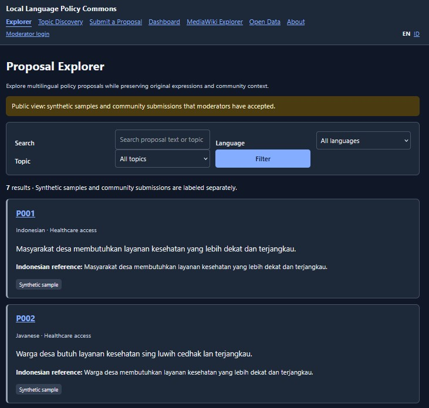
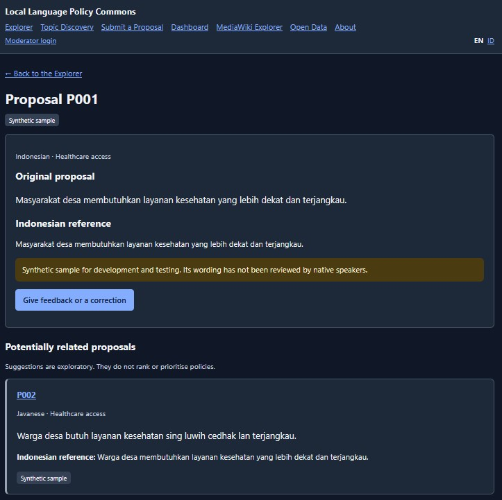
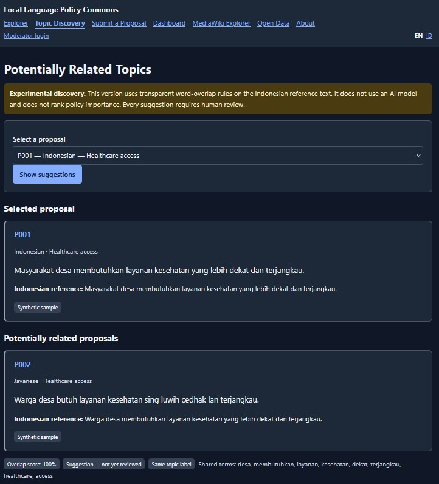
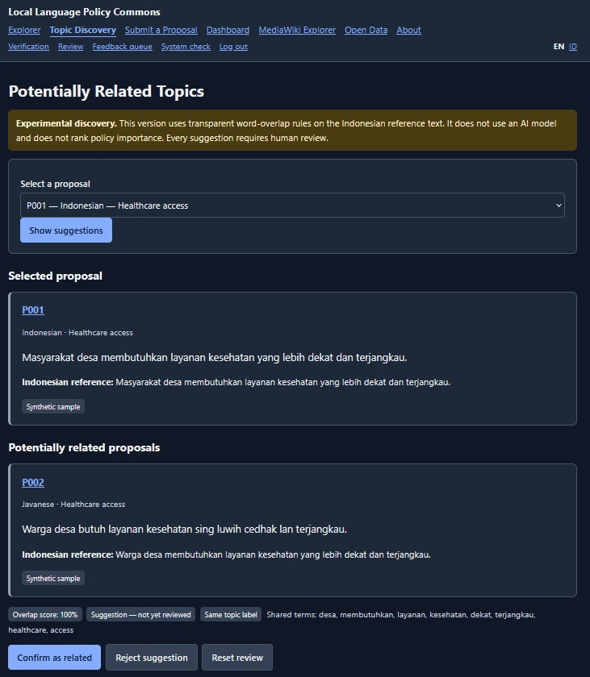
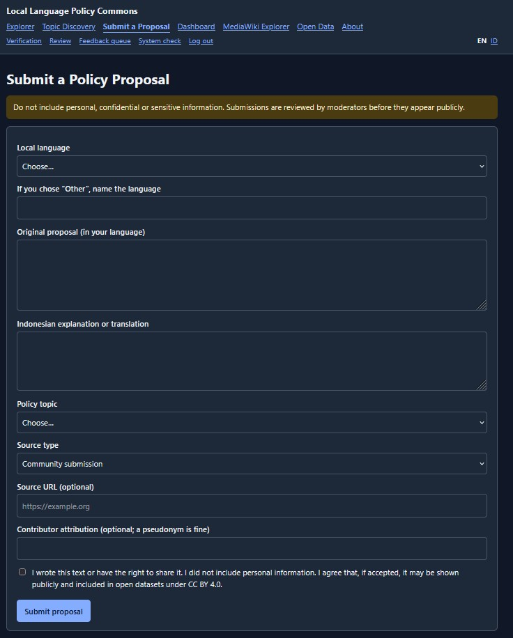
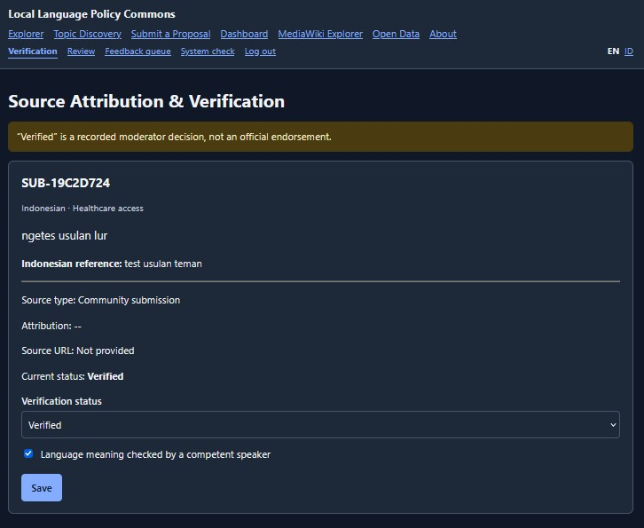
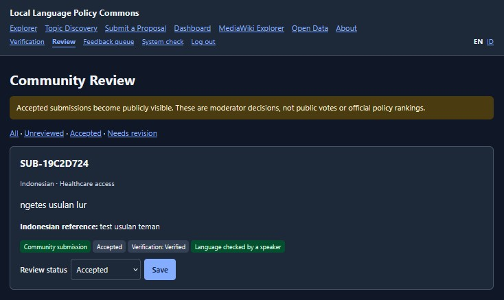
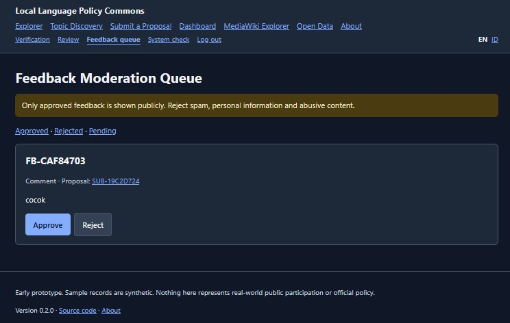
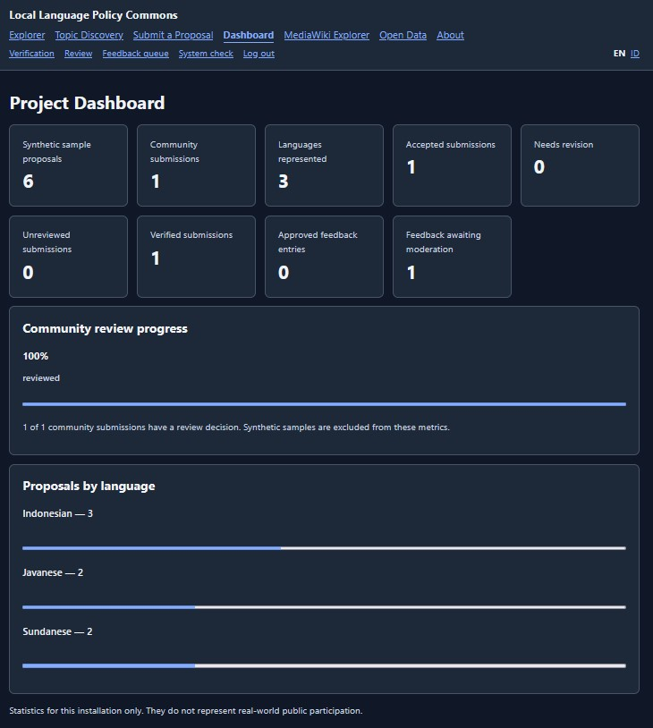

# Local Language Policy Commons

[](https://github.com/ArkFunDev/local-language-policy-commons/actions/workflows/ci.yml)
[](LICENSE)


**An open-source, human-in-the-loop tool for exploring policy proposals written in Indonesia's local languages — without flattening them into one language.**

🇮🇩 [Baca dalam Bahasa Indonesia](README.id.md)

## Why this exists

Young people across Indonesia write policy proposals in their own local languages. The volume and linguistic diversity make it hard to see where proposals overlap, who is raising similar concerns, and which ideas deserve a closer look. Most digital tools assume one dominant language and ask communities to translate themselves.

Local Language Policy Commons takes the opposite approach:

- **Original wording is the source of truth.** Every proposal is shown in its original language, with an Indonesian reference text alongside it, never instead of it.
- **Software suggests, people decide.** Cross-language topic suggestions are exploratory. Moderators and speakers confirm or reject each one, and the interface always shows which is which.
- **No ranking of ideas.** The system never scores policy importance or "popularity".
- **Transparent by default.** Every suggestion lists the exact terms that produced it.

The project is an independent effort aligned with the mission of [BASAibu](https://basabali.org), a community-governed platform for youth civic participation in local languages. It is **not** an official BASAibu product unless and until stated otherwise.

## Current status — working prototype (v0.2)

## Screenshots

> Demo data is synthetic. Screenshots show the v0.2 prototype.

### Explore and discover

| | |
|---|---|
|  |  |
| **Explore** proposals in their original languages | **Detail:** original wording first, Indonesian as reference |
|  |  |
| **Explainable suggestions** show the shared terms | **Humans decide:** confirm or reject each pair |

### Contribute and moderate

| | |
|---|---|
|  |  |
| **Submit** with explicit licence consent | **Verify** source, attribution and language meaning |
|  |  |
| **Review:** only accepted submissions become public | **Feedback is moderated** before it appears publicly |

### Overview



**Dashboard** for the installation: review progress and counts by language.

This repository contains a functioning prototype you can run in a minute. Please read the honest summary below.

**What works today**

| Area | Capability |
|---|---|
| Explore | Search, filter by language/topic, paginated explorer; per-proposal detail pages with `lang` attributes for correct screen-reader pronunciation |
| Submit | Public submission form with 22 language options, topic list, source attribution, explicit licence consent, honeypot and rate limiting |
| Moderate | Moderator login (rate-limited), source verification, review/accept workflow, feedback moderation queue, audit log |
| Discover | Transparent word-overlap suggestions with shared terms shown; moderators can confirm or reject each suggested pair |
| Integrate | Read-only MediaWiki API client (HTTPS, cached, descriptive User-Agent); moderators can import a wiki page as a *pending* submission |
| Open data | Public JSON/CSV export of accepted, consented records (CSV is protected against formula injection) |
| Quality | Bilingual UI (English / Bahasa Indonesia), accessible markup, dark mode, no JavaScript, strict Content-Security-Policy, automated tests and CI |

**What is *not* claimed**

- No production deployment and no real users. Figures in the dashboard describe only the local installation.
- The 6 sample proposals are **synthetic**; their local-language wording has **not** been reviewed by native speakers.
- Similarity currently uses a simple, transparent **word-overlap baseline on the Indonesian reference text**. It is *not* a machine-learning model. Evaluating small, privacy-preserving multilingual models — and measuring how they perform across languages — is planned work (see [docs/EVALUATION-PLAN.md](docs/EVALUATION-PLAN.md)).
- Storage is JSON files with one shared moderator password. That is fine for a prototype, not for production with sensitive data (see [SECURITY.md](SECURITY.md) and [docs/SYSTEM-ARCHITECTURE.md](docs/SYSTEM-ARCHITECTURE.md)).

## Quick start

Requirements: PHP 7.4+ with the `json`, `mbstring` and `curl` extensions. No Composer, no database.

```bash
git clone https://github.com/ArkFunDev/local-language-policy-commons.git
cd local-language-policy-commons

php bin/set-moderator-password.php     # creates config/config.local.php (git-ignored)
php tests/run.php                       # optional: run the test suite
php -S localhost:8000 -t public         # start the app
```

Open <http://localhost:8000>. Moderator tools: <http://localhost:8000/login.php>.

**Docker:** `cp .env.example .env`, put your password hash in it, then `docker compose up --build`. See [docs/DEPLOYMENT.md](docs/DEPLOYMENT.md) for Docker, XAMPP, Apache, nginx and the production hardening checklist.

## Repository layout

```
public/          Web root: pages and assets (the only directory that should be served)
src/             Application code (config, storage, security, i18n, proposals, similarity, MediaWiki)
lang/            UI strings: en.php, id.php
config/          config.example.php  (copy to config.local.php — never commit it)
storage/         Runtime data (git-ignored; keep outside the web root in production)
sample-data/     Synthetic demo proposals
bin/             Command-line helpers
tests/           Test runner (php tests/run.php)
docs/            Architecture, deployment, MediaWiki integration, responsible AI, evaluation plan, fellowship reference
```

## Documentation

- [System architecture](docs/SYSTEM-ARCHITECTURE.md) — components, data model, security model, prototype vs. planned
- [Wireframes and screens](docs/WIREFRAME.md)
- [MediaWiki integration](docs/MEDIAWIKI-INTEGRATION.md)
- [Responsible AI statement](docs/RESPONSIBLE-AI.md)
- [Evaluation plan](docs/EVALUATION-PLAN.md)
- [Deployment guide](docs/DEPLOYMENT.md)
- [Roadmap](ROADMAP.md) · [Changelog](CHANGELOG.md)
- [Privacy](PRIVACY.md) · [Security policy](SECURITY.md)
- [Mozilla Fellowship application reference](docs/MOZILLA-FELLOWSHIP.md)

## Guiding principles

Linguistic diversity and inclusion · Community ownership and human oversight · Transparency and responsible AI · Privacy by design · Open source and open data · Public-interest technology

## Contributing

Contributions are welcome — especially from **native speakers** of Indonesian local languages, accessibility reviewers and PHP developers. Please read [CONTRIBUTING.md](CONTRIBUTING.md) and the [Code of Conduct](CODE_OF_CONDUCT.md). To report a language error, use the *Language correction* issue template.

## Licence

- **Source code:** [MIT](LICENSE)
- **Documentation and synthetic sample data:** [CC BY 4.0](https://creativecommons.org/licenses/by/4.0/)
- **Community-submitted proposals:** published under the data licence configured by each installation (default CC BY 4.0), as agreed by contributors when they submit.

---

**Developer:** Helmy Ashari · **GitHub:** [@ArkFunDev](https://github.com/ArkFunDev)
