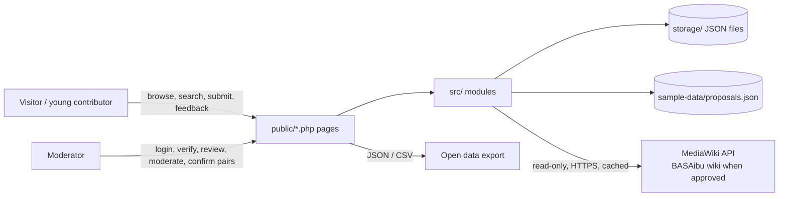
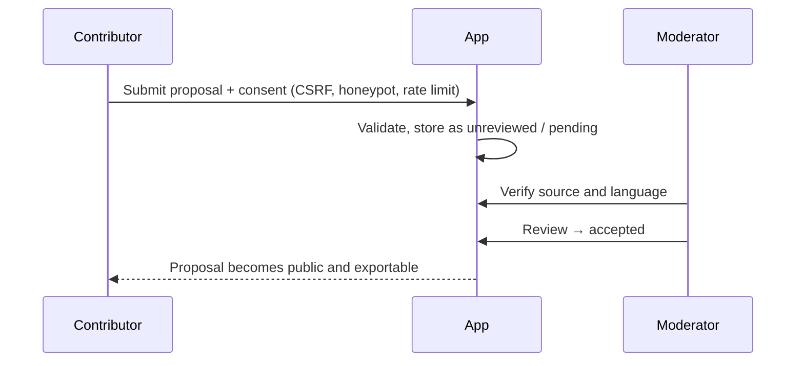

# System Architecture

Local Language Policy Commons is a small, dependency-free PHP application. This document describes what **exists today (v0.2 prototype)** and what is **planned**, and keeps the two clearly separate.

## 1. Overview

Design choices: no JavaScript, no third-party requests from the browser, one web root (`public/`), all state in `storage/`.

## 2. Components

| Module | File | Responsibility |
|---|---|---|
| Configuration | `src/config.php` | Defaults → `config/config.local.php` → `LLPC_*` environment variables |
| Storage | `src/storage.php` | Locked, atomic JSON read-modify-write; IDs; audit log; hashed rate limiting |
| Security | `src/security.php` | Escaping, headers (CSP etc.), sessions, CSRF, input cleaning, moderator auth |
| i18n | `src/i18n.php`, `lang/` | English and Bahasa Indonesia UI strings |
| Proposals | `src/proposals.php` | Languages, topics, normalising, validation, persistence, export |
| Similarity | `src/similarity.php` | Transparent word-overlap baseline and pair review |
| MediaWiki | `src/mediawiki.php` | Read-only Action API client |
| Layout | `src/layout.php` | Shared page shell and view helpers |

## 3. Data model (prototype)

Files in `storage/` (git-ignored):

| File | Content |
|---|---|
| `submissions.json` | Community proposals |
| `feedback.json` | Community feedback |
| `similarity_reviews.json` | Moderator decisions on suggested pairs |
| `ratelimit.json` | HMAC-keyed attempt timestamps (24 h) |
| `audit.log` | One JSON line per moderator action |
| `secret.key` | Per-installation secret for HMAC |
| `cache/` | Cached MediaWiki responses |

**Submission record**

| Field | Notes |
|---|---|
| `id` | `SUB-XXXXXXXX` |
| `language`, `language_name` | ISO 639 code (or `other`) and display name |
| `original_text` | Verbatim, never altered by the system (≤ 2000 chars) |
| `indonesian_gloss` | Indonesian explanation/translation used as the reference text |
| `suggested_topic` | One of a fixed topic list |
| `source_type`, `source_url`, `attribution` | Provenance; attribution may be a pseudonym |
| `verification_status` | `pending` / `verified` / `needs_clarification` |
| `language_verified` | A competent speaker checked the meaning |
| `status` | `unreviewed` / `accepted` / `needs_revision` — only `accepted` is public |
| `license_consent`, `is_synthetic`, `submitted_at` | Consent, synthetic marker, timestamp |

A planned relational schema is in [schema.mysql.sql](schema.mysql.sql). **It is not used by the prototype.**

## 4. Key flows

**Submit → publish**

**Cross-language suggestion**

1. Tokenise the Indonesian reference text and topic label of two proposals.
2. Score Jaccard overlap; add +25 points (capped at 100) when topic labels match.
3. Show the score **and the shared terms**; label every pair *unreviewed*, *confirmed* or *rejected*.
4. Moderators confirm or reject; rejected pairs are hidden from the public.

## 5. Security model

| Threat | Mitigation in v0.2 |
|---|---|
| XSS | Escape all output; CSP `default-src 'none'`, no JS, no inline styles |
| CSRF | Per-session token on all POST forms; logout is POST |
| Session theft / fixation | HttpOnly, SameSite=Lax, Secure on HTTPS, strict mode, regenerate on login, idle timeout |
| Brute force | Login rate limit; no default password; weak passwords rejected; hash-only storage |
| Spam / abuse | Honeypot, per-client rate limits, moderation before publication, record caps |
| Data corruption | Locked writes; refusal to overwrite invalid JSON |
| Data exposure | `storage/` outside web root; deny rules for Apache; guidance for nginx |
| SSRF | MediaWiki endpoint is admin-configured, HTTPS only, limited redirects |
| CSV injection | Cells starting with `= + - @` are prefixed |
| Privacy | No accounts, no analytics, no raw IP storage |

Not yet covered: per-moderator accounts and roles, 2FA, external security audit, centralised logging. These are listed in the [roadmap](../ROADMAP.md).

## 6. Prototype vs. planned

| Capability | v0.2 prototype | Planned |
|---|---|---|
| Storage | JSON files | MySQL/MariaDB (schema drafted) |
| Auth | Shared moderator password | Per-moderator accounts, roles, optional 2FA |
| Wiki integration | Read-only search/category + import to queue | Sync with BASAibu wiki structure agreed in Q1 |
| Similarity | Word-overlap on Indonesian reference text | Evaluate small, locally-run multilingual embedding models against this baseline, per language |
| Evaluation | Unit tests | Native-speaker evaluation, per-language error analysis ([plan](EVALUATION-PLAN.md)) |
| Hosting | Any PHP host / Docker | BASAibu infrastructure |

## 7. Extending

- **New language:** add to `llpc_languages()` in `src/proposals.php`.
- **New topic:** add to `llpc_topics()` and add `topic.<slug>` to both `lang/` files.
- **New UI language:** see [CONTRIBUTING.md](../CONTRIBUTING.md).
- **New storage backend:** replace the functions in `src/storage.php` and the persistence section of `src/proposals.php`; pages only call those functions.
